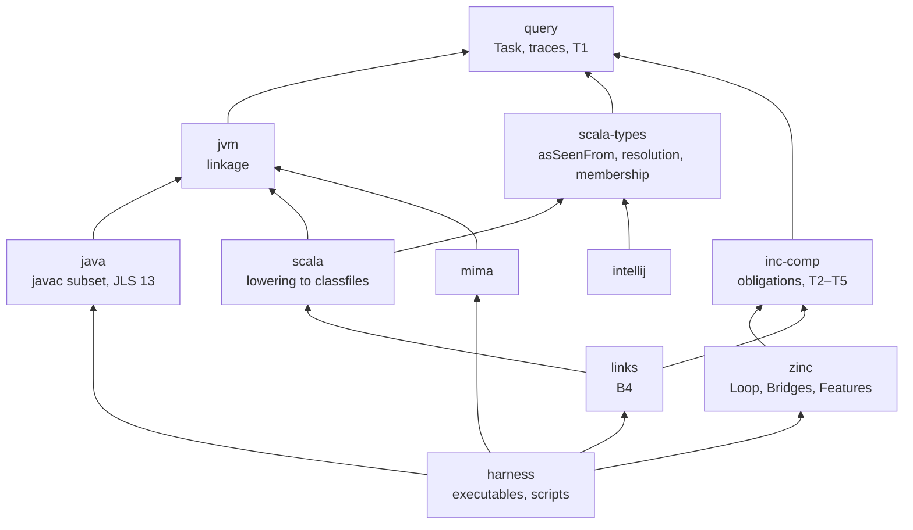

# Lean models of the JVM, Java, Scala, incremental compilation, Zinc, MiMa and IntelliJ

Lean 4 models of the tools that build JVM languages, layered so that each answers one question and each is calibrated against the real tool before anything is built on it:

- **the JVM**: when does a classfile link against a library, and to which method;
- **Java** and **Scala**: what javac, scalac and dotc emit, and how Scala types are computed;
- **incremental compilation**: when an incremental build equals a clean one, for any compiler and policy;
- **Zinc**: its loop, its bridges and each language feature as an instance of that framework;
- **MiMa**: which library edits it reports and which it misses;
- **the IntelliJ Scala plugin**: when its substitutor chains agree with scalac's `asSeenFrom`.

The Zinc model's hypotheses are the point: they are the specification a compiler bridge must meet. Nothing here verifies scalac; the models are calibrated against it.

History: the Zinc model started in retronym/talks (`zinc-incrementality/lean/`, moved here with its history from talks `b9058db`), the IntelliJ model in retronym/scala-type-system-tck (`lean/`, likewise). [`docs/history/repository-split.md`](docs/history/repository-split.md) has the plan and the record of the split.

```bash
lake exe cache get && lake build
```

Lean `v4.34.0`, Mathlib `v4.34.0`, one toolchain for the workspace and its doc builds (doc-gen4 and Verso `v4.34.0`). `lake build` at the root builds `All`, which imports every library. `MiMa.Sound` and `Scala.Refchecks` are outside it: `lake build MiMa.Sound` (about 45 minutes), `lake build Scala.Refchecks` (about 20 minutes).

## Packages

Each package under `packages/` has its own Lake configuration and a README with the question it answers, where to start, its calibration and its gaps. Imports go one way: the core layers never import a consumer.



| package | question | Mathlib |
|---|---|---|
| [`query`](packages/query/README.md) | a computation that asks questions, and why its trace is enough (T1) | no |
| [`jvm`](packages/jvm/README.md) | when a classfile links, and to which method | no |
| [`java`](packages/java/README.md) | what javac emits; JLS chapter 13 | no |
| [`scala-types`](packages/scala-types/README.md) | `asSeenFrom`, resolution, membership, as scalac computes them | no |
| [`scala`](packages/scala/README.md) | what scalac and dotc emit | no |
| [`intellij`](packages/intellij/README.md) | when the IntelliJ plugin's substitutor chains agree with scalac | no |
| [`inc-comp`](packages/inc-comp/README.md) | when an incremental build equals a clean one, for any compiler and policy | yes |
| [`zinc`](packages/zinc/README.md) | Zinc's loop, bridges and features as instances | yes |
| [`mima`](packages/mima/README.md) | what MiMa reports and misses; corrected rules | yes |
| [`links`](packages/links/README.md) | B4: Zinc-clean implies binary-compatible | yes |
| [`harness`](packages/harness/README.md) | executables and scripts that drive the calibration | yes |

Each package also has a `Spec` module (`Query.Spec`, `IncComp.Spec`, `Zinc.Spec`, …): its key definitions and theorems stated in prose, each name checked by the build. Sizes per package are in [`docs/stats.md`](docs/stats.md), generated. API documentation for every library is built by doc-gen4 (`cd docbuild && lake build All:docs`).

The literate pages in [`literate/`](literate/) read the models next to the specifications: each quotes the JLS, JVMS or SLS clause it models, includes the model's docstrings, and checks an example by evaluation and by the kernel. Built with Verso (`cd literate && lake exe literate --output _out`). [`scripts/check_quotes.py`](scripts/check_quotes.py) checks every quotation against the specification verbatim, and keeps the Oracle quotations within a word budget. The [`Pages`](.github/workflows/pages.yml) workflow publishes both to [retronym.github.io/jvm-lang-models](https://retronym.github.io/jvm-lang-models/): the literate pages at the root on every push, the API documentation under [`api/`](https://retronym.github.io/jvm-lang-models/api/) when the workflow is run by hand with `api` ticked.

The Mathlib-free packages can be required on their own, for example [`packages/intellij`](packages/intellij) by `git … subDir`, as the TCK does.

## Start here, by goal

**Understand the theory.** Read [`packages/query/Query/Task.lean`](packages/query/Query/Task.lean) (a compilation as a query tree with a trace), then [`packages/inc-comp/IncComp/Model.lean`](packages/inc-comp/IncComp/Model.lean) (the specification's first page: `Compiler`, `Obligations`, `round`, `zinc`), then [`packages/inc-comp/IncComp/General.lean`](packages/inc-comp/IncComp/General.lean) ([`XCompiler`](packages/inc-comp/IncComp/General.lean#L22), where T2, T3a, T4 and T5 are proved once). [`packages/inc-comp/IncComp/Uniqueness.lean`](packages/inc-comp/IncComp/Uniqueness.lean) and [`packages/zinc/Zinc/Loop/Cycles.lean`](packages/zinc/Zinc/Loop/Cycles.lean) show when incremental equals clean and where it fails. The statements are in [The theorems](#the-theorems); [`docs/specification.md`](docs/specification.md) gives the rationale for the method.

**Start from a bug you know.** [`docs/evidence/bug-map.md`](docs/evidence/bug-map.md) maps 145 Zinc and compiler bugs to the part of the model that expresses them, or to a gap.

**Add a language feature to the Zinc model.** [`packages/zinc/Zinc/Features/Sam.lean`](packages/zinc/Zinc/Features/Sam.lean) is the template: the compiler's algorithm as the unit task of a [`TCompiler`](packages/inc-comp/IncComp/Tree.lean#L26), today's bridge as keys, the failing cases as witnesses ([`p1_today`](packages/zinc/Zinc/Features/Sam.lean#L565), [`p2_today`](packages/zinc/Zinc/Features/Sam.lean#L571)), the fix with `obligations_fix` and `fix_sound`. [`packages/zinc/docs/28-sam.md`](packages/zinc/docs/28-sam.md) has the question behind it. The witnesses became scripted tests in [retronym/zinc#58](https://github.com/retronym/zinc/issues/58), which fail on `develop` as predicted. The gap clusters in [`docs/evidence/bug-map.md`](docs/evidence/bug-map.md) are the candidate features.

**Test Zinc.** The conformance harness (`sbt.internal.inc.bench.Conformance`, from [retronym/zinc#25](https://github.com/retronym/zinc/issues/25)) renders each program of a dump, applies each edit, and compares the incremental build's classfiles with a clean build's. `lake exe conformance` and `lake exe jconformance` write the dumps; the analysis scripts are in [`packages/harness/scripts/`](packages/harness/scripts). The workflow is in [`packages/zinc/docs/10-names.md`](packages/zinc/docs/10-names.md) and [`packages/zinc/docs/12-java.md`](packages/zinc/docs/12-java.md); pending tests in [`docs/evidence/tests.md`](docs/evidence/tests.md).

**Maintain javac, scalac or dotc.** [`packages/java`](packages/java), [`packages/scala`](packages/scala) and [`packages/scala-types`](packages/scala-types) state what the compilers emit for a subset, calibrated by the probes beside them. [`packages/scala/Scala/Facts.lean`](packages/scala/Scala/Facts.lean) and the `comp` failures in the bug map are where joint and separate compilation differ.

**Maintain MiMa.** [`packages/mima`](packages/mima): MiMa as a bridge design, its six gaps, corrected rules; [`packages/links`](packages/links) connects it to Zinc (B4).

**Maintain the IntelliJ Scala plugin.** [`packages/intellij`](packages/intellij): the theorems behind the plugin's substitutor checks, on top of `ScalaTypes.AsSeenFrom`.

## The theorems

This is the canonical statement of the obligations and T1–T5; other documents point here.

**The obligations.** A compiler is a per-unit task that queries an oracle, plus a bridge: `keys` (what it records), `π` (a hash per key) and `covers` (which queries a key vouches for). On [`XCompiler`](packages/inc-comp/IncComp/General.lean#L22) ([`XCompiler.Obligations`](packages/inc-comp/IncComp/General.lean#L46)):

- **comp** (compositionality): joint compilation of a group is a fixed point of the per-unit tasks, with group-mates answered from their fresh interfaces;
- **coverage**: every traced query, misses included, is covered by a recorded key;
- **abstraction**: equal hashes on a key give equal answers to every query it covers;
- **locality**: a key's hash reads only the interfaces in its declared `hashDeps`.

The local [`IncComp.Compiler`](packages/inc-comp/IncComp/Model.lean#L28) has the first three. The policy's one obligation is [`Policy.Sound`](packages/inc-comp/IncComp/Model.lean#L119): never drop an invalidated unit outside the round just compiled.

| | Name | Statement | Hypotheses |
|---|---|---|---|
| T1 | [`Task.run_eq_of_trace`](packages/query/Query/Task.lean#L40) | Oracles that agree on a run's trace give the same output and trace | none |
| T2 | [`XCompiler.round_preserves`](packages/inc-comp/IncComp/General.lean#L109) | One round, with `Δ` over the affected units, preserves the invariant | the obligations; dirty set `D ⊆ R` |
| T3a | [`XCompiler.zinc_sound`](packages/inc-comp/IncComp/General.lean#L242) | If the loop returns, every unit is up to date: a per-unit fixed point | plus [`Policy.Sound`](packages/inc-comp/IncComp/Model.lean#L119) |
| T3b | [`Compiler.fixpoint_unique_of_wf`](packages/inc-comp/IncComp/Uniqueness.lean#L66), `_of_explicit` | Per-unit fixed points are unique | traced dependencies well-founded under every oracle, or every interface a function of the source alone |
| T3 | [`Compiler.zinc_eq_clean_of_wf`](packages/inc-comp/IncComp/Uniqueness.lean#L122), `_of_explicit` | Incremental = clean | T3a's and T3b's; on `Compiler`, and on [`TCompiler`](packages/inc-comp/IncComp/Tree.lean#L26) through `toCompiler` (`:189`, `:204`) |
| T4 | [`XCompiler.zinc_some_of_monotoneFrom`](packages/inc-comp/IncComp/General.lean#L291); [`Compiler.zinc_some_of_explicit`](packages/inc-comp/IncComp/Termination.lean#L99), `_of_wf` | The loop returns within a bound: `k + \|S\| + 1` rounds; 2; height + 2 | a policy monotone from round `k` (`transitiveStep`); or T3b's hypotheses, `Compiler` only |
| | [`PingPong.zinc_diverges`](packages/zinc/Zinc/Loop/PingPong.lean#L219) | Without `transitiveStep`, Zinc's loop diverges for every fuel on three mutually inferred classes | kernel `decide` |
| T5 | [`XCompiler.downstream_sound`](packages/inc-comp/IncComp/General.lean#L389) | A downstream subproject's loop, seeded from changed sources and external invalidations, ends sound against the new classpath | fresh snapshots; T5a `inv_external` (`:281`) needs only abstraction |
| | [`Stale.stale_unsound`](packages/inc-comp/IncComp/Stale.lean#L132), [`stale_affected`](packages/inc-comp/IncComp/Stale.lean#L137) | T2-stale: a non-local hash diffed over the recompiled set alone undercompiles; over `affected` it does not | kernel `decide` |
| | [`Cycles.zinc_ne_clean`](packages/zinc/Zinc/Loop/Cycles.lean#L191), [`annotated_eq_clean`](packages/zinc/Zinc/Loop/Cycles.lean#L220) | T3a without T3 for inferred types in a cycle; T3 when every member is annotated | |
| B4 | [`XCompiler.untouched_eq_clean`](packages/inc-comp/IncComp/General.lean#L578) | A unit Zinc never recompiles equals the clean build's, so it links as a fresh build does | explicit interfaces, through [`XCompiler.fixpoint_unique_of_explicit`](packages/inc-comp/IncComp/General.lean#L547) (`:100`) |
| | [`zinc_sound_charged`](packages/zinc/Zinc/Loop/Files.lean#L176) | T3a with file-closed rounds and imports charged to one class of the file | charged obligations; file-closed policy |

**Where the hypotheses bite.**

- Abstraction is perfect hashing: collisions of Zinc's 32-bit name hashes are excluded by fiat.
- T3's well-founded case covers every traced query under every oracle, which rules out self-queries and body-level cycles; uniqueness should need only that the dependencies affecting interfaces are well-founded ([sbt/zinc#1284](https://github.com/sbt/zinc/issues/1284)'s condition). Its explicit case needs every interface independent of every oracle, so a mix of annotated and inferred members is unproved.
- T3 and T4's explicit and well-founded cases are on `Compiler` (and [`TCompiler`](packages/inc-comp/IncComp/Tree.lean#L26) for T3). On [`XCompiler`](packages/inc-comp/IncComp/General.lean#L22) only the explicit T3b exists, inside `BinCompat`.
- `comp` fails for F4, F5 and F6 ([`SplitProof.Spec.joint_not_comp`](packages/zinc/Zinc/Features/SplitProof.lean#L952), [`ZincBridgeScala3.not_comp`](packages/links/Links/ZincBridgeScala3.lean#L79)).
- The set of units is fixed; additions and deletions are absent sources ([`Added.lean`](packages/zinc/Zinc/Features/Added.lean)).
- T3a covers only runs that return within fuel.
- Precision has no framework definition; it is proved per instance.

## Trust

- No `sorry`, `admit` or `axiom` declarations.
- `native_decide` appears only in `example`s, never in a `theorem` or `lemma`: those are checks on a bounded space, not results (docs/specification.md). [`scripts/lint_native_decide.py`](scripts/lint_native_decide.py) enforces this over every `.lean` file of every package, in CI.
- [`scripts/Axioms.lean`](scripts/Axioms.lean) prints the axioms of the core theorems, of the counterexamples proved by `decide`, and of the instances' soundness theorems; [`scripts/check_axioms.py`](scripts/check_axioms.py) fails unless each uses only `propext`, `Classical.choice` and `Quot.sound` (so no `sorryAx` and no `Lean.ofReduceBool`), in CI.

## Documents

Documents link every file, Lean file name and GitHub reference they mention; [`scripts/lint_links.py`](scripts/lint_links.py) checks this in CI, and `python3 -I scripts/lint_links.py --fix` writes the missing links.


[`docs/README.md`](docs/README.md) is the index, by what a document is for:

- **current**: [`docs/status.md`](docs/status.md) (what is proved and what is checked), [`docs/specification.md`](docs/specification.md) (why the model is a specification), [`docs/roadmap.md`](docs/roadmap.md) (open work);
- **evidence**: [`docs/evidence/`](docs/evidence) (the bug catalogue, the scripted-test catalogue, and the bug map that ties them to the model);
- **per package**: each package's `docs/` (the Zinc phase records `packages/zinc/docs/NN-topic.md`, the calibration tracks);
- **history**: [`docs/history/`](docs/history) (the phase log, the reviews, the record of the repository split).
