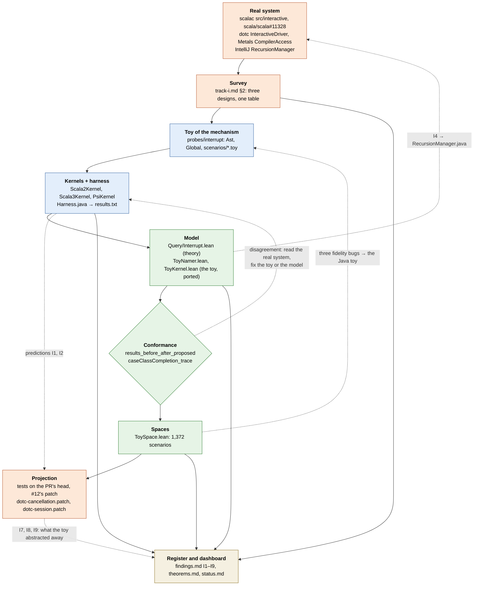

# The method: from a real bug to a model and back

22 October 2026. How Track I ([`track-i.md`](../packages/scala/docs/track-i.md), [`track-i-scala3-cancellation.md`](../packages/scala/docs/track-i-scala3-cancellation.md)) was done, written down so that it can be done again. Track L ([`track-l.md`](../packages/scala/docs/track-l.md)) is the precedent: the same rungs, climbed with probes instead of a toy. The product of the method is the findings register ([`findings.md`](findings.md)); the theorems are how it earns them.

## Summary for a busy reader

Start from a real system and a real bug. Read the system's source for the mechanism the bug lives in, and read two or three other systems that have the same mechanism. Write a *toy implementation of the mechanism*, not of the language, small enough that every interleaving, every order and every program of a menu can be enumerated, with each real system's design as a *kernel* under one harness. Port the toy into a formal model whose definitions are read off the toy, so that the toy's recorded output becomes a theorem about the model; where they disagree, one of them is wrong, and the real system decides which. Run the model over spaces the toy never ran. Project what the model says back onto the real system as tests and patches, and confirm or refute each prediction there. Keep a findings register and a status page throughout. Track I climbed every rung in two days; nine findings, two confirmed on scalac with tests, two patches on dotc that pass its suites.

## 1. The ladder

Each rung: what it is for, what it costs, what it finds and cannot find, and the artefact it leaves. Track I is the example at every rung.

### 1.1 The real system: sources, a PR, a bug

**For.** Grounding. The mechanism is named by the system's own identifiers, the bug by its test, and everything that follows is held to them.

**Costs.** Hours of reading. For Track I: scalac's `src/interactive` (where `signalDone` services requests inside a type check), the five commits of [scala/scala#11328](https://github.com/scala/scala/pull/11328) and the flaky tests they fix ([scala-dev#840](https://github.com/scala/scala-dev/issues/840), [#915](https://github.com/scala/scala-dev/issues/915)).

**Finds.** The shape of the bug as its author understood it. Cannot find: whether the fix is complete, or what other shapes the mechanism allows. A reviewer's question on the PR, whether a soak test over random interleavings would pass, is the question the rest of the ladder answers.

**Leaves.** [`track-i.md`](../packages/scala/docs/track-i.md) §1: the mechanism in one paragraph, and the table of the PR's commits against the kind of state each one repairs.

### 1.2 The survey across systems

**For.** Separating the mechanism from one system's implementation of it. Three systems that answer requests mid-check take three positions; a design space appears only when there is more than one point in it.

**Costs.** A day of reading per system, by someone who can read the system. Track I read dotc's `InteractiveDriver` and Metals' `CompilerAccess`, and IntelliJ's `RecursionManager` and `CachedValuesManager`, at named commits.

**Finds.** The axes: where a request runs (nested, after the run, on another thread), what the black hole is and whether an unwind resets it, what is cached and under what key, how cancellation arrives. Cannot find: what happens under an interleaving nobody has run; the survey reads code, it does not execute it.

**Leaves.** [`track-i.md`](../packages/scala/docs/track-i.md) §2, one subsection per system with file and line references, and the one-line comparison that closes it. Findings that need no more than reading start here: I6 (dotc's 3.8 cancellation callback can never fire) was found by reading `Run.Progress.checkCancellation` against the callback it calls.

### 1.3 The toy: the mechanism over a toy language

**For.** An executable that is small enough to enumerate. The language is cut down to what the mechanism needs and nothing else: Track I's has classes, objects and traits with members whose types are declared or inferred from a path, and no expressions, because inference is what forces other facts, and forcing is what a request lands inside. Synthetics, implicit views, warnings and suppression are in it because the PR's five commits are about them.

**Costs.** About 1,100 lines of Java, a day. The cost that matters is fidelity: every design choice in the toy is a claim about the real system, and the wrong ones are found later (§4).

**Finds.** The bugs the PR fixed, reproduced by mechanism: a partial burst and the all-or-nothing skip, a consumed map, a replaced symbol in a cache, a premature completeness claim. And bugs the PR did not fix: I1 and I2, a whole-unit request served nested, which the PR's `uninterruptible` windows do not cover. Cannot find: anything about trees, positions or edits inside a body, which the language does not have; anything about the systems' real cost, which the toy's work counter only ranks.

**Leaves.** [`packages/scala/probes/interrupt`](../packages/scala/probes/interrupt): [`Ast.java`](../packages/scala/probes/interrupt/src/pctoy/Ast.java) (the language), [`Global.java`](../packages/scala/probes/interrupt/src/pctoy/Global.java) (the shared symbol table with completers, the black hole and `signalDone`), the scenarios in [`scenarios/`](../packages/scala/probes/interrupt/scenarios), one per test of the PR plus the shapes the PR does not have, and [`run.sh`](../packages/scala/probes/interrupt/run.sh).

### 1.4 The other systems as kernels of the same toy, one harness

**For.** Comparison under one oracle. Each surveyed design becomes a `Kernel` over the same symbol table and the same scenarios, so the designs are compared on the same inputs with the same notion of divergence, and the harness is written once. A hypothetical design costs one more kernel: `dotc-interrupted` asks what dotc would do if an interrupt did land mid-run, which no real deployment does.

**Costs.** A few hundred lines per kernel. The harness itself is the hard part to get right: Track I's injects one event at every safepoint of the background work on a fresh kernel, and compares the answers with the event sent after the background finished, on another fresh kernel.

**Finds.** Where the designs differ and what each pays: the scalac kernels diverge at 8–13 of 14–18 safepoints before the PR and at none after, except the whole-unit shape; the dotc and PSI kernels diverge at none, by construction, and the work column shows what that costs. Cannot find: a divergence at a safepoint the kernel does not have, which is why the Java and Lean kernels' safepoint counts are compared by name (§4).

**Leaves.** The kernels table in [`track-i.md`](../packages/scala/docs/track-i.md) §3, [`Harness.java`](../packages/scala/probes/interrupt/src/pctoy/Harness.java), and [`results.txt`](../packages/scala/probes/interrupt/results.txt), the table of divergent safepoints per scenario per kernel, regenerated by `run.sh` and committed.

### 1.5 The model: definitions derived from the toy, theorems over its programs

**For.** Statements that hold for every program, not for the scenarios that were run. Two layers in Track I. [`Query/Interrupt.lean`](../packages/query/Query/Interrupt.lean) states the theory over Track L's lazy facts: a forcing cut at any safepoint leaves a store that agrees with the semantics ([`forceA_agree`](../packages/query/Query/Interrupt.lean#L158)), so abort and restart is sound, nested servicing with an empty stack is a reordering ([`nested_empty_stack_reorders`](../packages/query/Query/Interrupt.lean#L378)), and each of the PR's non-fact shapes (a burst, a consumed map, an identity cache) is a model the size of the mechanism. Then [`ToyNamer.lean`](../packages/scala-types/ScalaTypes/ToyNamer.lean) derives the facts of any program of the toy language ([`rulesOf`](../packages/scala-types/ScalaTypes/ToyNamer.lean#L274)) and [`ToyKernel.lean`](../packages/scala-types/ScalaTypes/ToyKernel.lean) is `Scala2Kernel.java` ported line for line where it matters, with every force taken from the namer's rules.

**Costs.** Two days of Lean, with no Mathlib and no `native_decide`, so that `decide +kernel` checks the executable parts. The port is not free of judgement: the Lean kernel keys facts by name where scalac reuses symbols by identity, which absorbs two of the Java policy's bits.

**Finds.** What the toy could only show: that the taint theorem for ranked rules is empty because no peek ever sees a fact in progress ([`forcePeek_ok`](../packages/query/Query/Interrupt.lean#L467)), and that IntelliJ's rule caches the re-entered frame, whose value depends on demand order (I4, [`psi_root_order_dependent`](../packages/query/Query/Interrupt.lean#L748)), which was then confirmed in `RecursionManager.java`. Cannot find: anything about state the model does not have (the dotc and PSI kernels are not ported yet, so their zero divergences are a theorem only in the shape of a reordering), and anything the executable semantics cannot decide in the time the kernel has (§4).

**Leaves.** The Lean modules, their rows in [`theorems.md`](theorems.md), and the claim-to-theorem table in [`track-i.md`](../packages/scala/docs/track-i.md) §5.

### 1.6 Conformance: the toy's output is a theorem about the model

**For.** Holding the model to the toy and the toy to the model. [`results_before_after_proposed`](../packages/scala-types/ScalaTypes/ToyKernel.lean#L774) states that for the seven scenarios of `results.txt` the background's safepoint counts and the divergent sets under the three scalac policies are exactly the Java harness's, and [`caseClassCompletion_trace`](../packages/scala-types/ScalaTypes/ToyKernel.lean#L765) that the safepoints of one scenario are the Java kernel's by name and in order. A disagreement is a bug in one of them; neither is the reference, the real system is.

**Costs.** The theorem is checked by the kernel in about 25 seconds. The real cost is the discipline of regenerating `results.txt` and restating the theorem whenever either side changes, which happened twice.

**Finds.** Fidelity bugs in either direction. The first port disagreed on one safepoint count and was wrong; the first space run (§1.7) disagreed on three mechanisms and the *Java* toy was wrong. Cannot find: a mistake both sides share, because both were written by the same hands from the same reading. The real system is the only check on that, which is §1.8.

**Leaves.** The two theorems, and `results.txt` under version control as the thing they are about.

### 1.7 Spaces the toy never ran

**For.** Exhaustion over a menu. The Lean kernel runs a scenario in milliseconds, so [`ToySpace.lean`](../packages/scala-types/ScalaTypes/ToySpace.lean) runs the harness over every program of two or three declarations from a menu of eight, in every order, with every completion and whole-unit request: 1,372 scenarios, under each policy.

**Costs.** Minutes of evaluation and a careful menu. The menu is the claim: it says which features interact, and a feature left out is a shape never tried.

**Finds.** First, the toy's own errors (§4). Then the one shape that survives every policy: the 57 completions that diverge under the proposal all have the case class declared after its consumer, at exactly the safepoints before the class's burst, which is the targeting gap and not a synthetics policy (I5, [`consumerFirst_proposed_before_burst`](../packages/scala-types/ScalaTypes/ToySpace.lean#L88)). Cannot find: shapes outside the menu, and interactions that need more declarations than the menu allows.

**Leaves.** The space module, its counts in [`track-i.md`](../packages/scala/docs/track-i.md) §10, and a findings row.

### 1.8 Projection back: tests and patches on the real system

**For.** Settling predictions where they are made, and leaving the real system better. A prediction from the toy or the model is a hypothesis about scalac or dotc until a test on scalac or dotc fails or passes as predicted.

**Costs.** The most expensive rung in wall-clock time: a scalac build per test, a two-minute bootstrapped rebuild of dotc per iteration of a patch. In Track I: I1 and I2 confirmed on the PR's head with two tests in the shape of the PR's own; a patch for scalac ([retronym/jvm-lang-models#12](https://github.com/retronym/jvm-lang-models/issues/12)) that passes the presentation suite and 26 case-class tests under `-Ycheck:typer`; two spikes on dotc, cancellation ([`dotc-cancellation.patch`](upstream/dotc-cancellation.patch), three tests) and the targeted resumable session ([`dotc-session.patch`](upstream/dotc-session.patch), four tests), 250 of 250 across the suites.

**Finds.** What the toy abstracted away. The dotc spikes found I7 (a completer refuses to run in a later run than its own), I8 (typing an untyped tree consumes attachments, so it is not idempotent) and I9 (a completion's cost on a wide file is the import search, not typing), none of which the toy could have, because it has no runs with identity, no attachments and no import search. Cannot find: anything the real system's tests do not reach; a prediction with no test is a row in triage, not a finding.

**Leaves.** Tests and patches in [`upstream/`](upstream/README.md), issues and PRs on the real trackers, and the findings' status moving from `triage` to `draft` to `filed`.

### 1.9 The register and the dashboard

**For.** Making the findings the product, and keeping the model's reach honest. Every rung writes rows to [`findings.md`](findings.md): what was found, in which system, the evidence (a theorem, a scenario, a test), the status and the next step. [`status.md`](status.md) says, per package, what is proved for every program and what is only checked on a space or calibrated against the real tool; [`theorems.md`](theorems.md) states the theorems once; [`stats.md`](stats.md) counts them.

**Costs.** A row per finding, a table row per theorem, and `lint_links.py`, which refuses a declaration named but not linked, so that a renamed theorem breaks the document that cites it.

**Finds.** Nothing by itself. It is where a reader starts, and where a finding that the model made and nobody confirmed stays visible as unconfirmed.

**Leaves.** Rows I1 to I9, the Track I rows of [`theorems.md`](theorems.md) and [`status.md`](status.md), and the future-work boxes at the end of each track note, ticked as they close.

## 2. The process

Red is the real system and what is done to it, blue the Java toy, green the Lean model, the register in parchment. The solid spine is the order the rungs were climbed. The dotted edges are the two feedback loops: from the model back to the toy (a conformance disagreement or a space result that reveals a wrong claim about the real system) and from the toy and the model forward to the real system (a prediction that becomes a test, a theorem that names a line of platform code). Every rung writes to the register.

## 3. Established terms, and where this differs

Each rung is a known technique; the combination and two reversals are what is particular here.

**Differential testing** [McKeeman 1998; Yang et al. 2011]. Several implementations of one specification are run on the same inputs and their disagreements are the bugs. The kernels under one harness (§1.4) are differential testing of *designs*, with the toy's reference answer, the request served after the background, as a fourth implementation. The reversal: the implementations are not independent systems but kernels written by one person from a survey, so a disagreement among them is informative and an agreement is not, which is why the real system is kept as the reference above them.

**Bounded exhaustive testing** [Runciman et al. 2008; Boyapati et al. 2002]. Every input up to a size bound, rather than random inputs [Claessen and Hughes 2000]. The space (§1.7) is SmallCheck's method on the menu, and the harness's injection at every safepoint is the same method over interleavings. Metamorphic testing [Chen et al. 1998] names the oracle the harness uses: the answer must not change when the request moves from after the background to a safepoint inside it, a relation between runs rather than an expected output.

**Golden models and co-simulation.** In hardware verification a reference model of the design, usually behavioural and untimed, runs beside the register-transfer design on the same stimulus, and a scoreboard compares them transaction by transaction. The conformance theorem (§1.6) is that scoreboard with the Lean kernel as the golden model, run once over the committed `results.txt`. The difference: here neither side is golden. The hardware flow trusts the reference model and debugs the design; this method debugs both, and the reversal has already paid, since three of the four disagreements were the toy's.

**Executable semantics and runnable specifications** [Roşu and Şerbănuţă 2010; Fuchs 1992; Hayes and Jones 1989]. The K framework's position is that a semantics should be executable so that it can be tested; Hayes and Jones's is that an executable specification is biased towards one implementation. Both apply. `rulesOf` and `ToyKernel` are executable, so `decide` and `#eval` test them against the toy, and they are biased towards scalac's kernel, which is why the dotc and PSI kernels are a future-work item and not a theorem.

**Lightweight formal methods** [Jackson 2012; Newcombe et al. 2015]. A partial model, analysed exhaustively within a small scope, on the bet that most bugs have small witnesses. The scope here is the menu and the safepoint budget; I5's witness is two declarations and one completion. Amazon's experience that engineers find TLA+ worth its cost once it finds a bug a test suite missed is the experience of §1.7: the targeting gap had passed every test in the PR. Model checking proper [Clarke et al. 1999] is what `decide +kernel` over the harness amounts to: a finite state space explored exhaustively, with the theorem prover as the checker.

**Refinement** [Abrial 2010; Back and von Wright 1998; Spivey 1992]. A chain of models, each more concrete, with a proof that each refines the last. The ladder is a refinement chain climbed from the wrong end: the real system is the most concrete, the toy abstracts it, the model abstracts the toy, and the theory of [`Query/Interrupt.lean`](../packages/query/Query/Interrupt.lean) abstracts the model. The reversal is that the definitions are *derived from the toy*, not from a specification; the method is for a system that has no specification of the mechanism, which is the usual case for a compiler's internals. Mechanised metatheory [Aydemir et al. 2005] is the version of this for a language with a specification, and its lesson, that the binding structure costs more than the theorems, has its counterpart here in the port's choice to key facts by name.

**Reference models of a computation** [Mokhov et al. 2018]. Build Systems à la Carte models seven build systems as instances of one `Task` type and compares them on the same axis. Track L's facts are its `Task`, and the kernels are its instances; the method is what that paper does, with a harness and a space added.

**Minimal reproductions** [Zeller and Hildebrandt 2002]. A bug report wants the smallest input that shows the failure. Delta debugging finds it by shrinking; the toy finds it by construction, since the language has nothing to remove, and the space finds the smallest scenario of each shape by enumerating from small to large. I1's test on scalac is the toy's scenario rewritten in Scala, which is what a toy is for.

**Programming as theory building** [Naur 1985]. The knowledge that matters about a program is the theory its builders hold, not the text. The survey (§1.2) recovers a theory from the text of three systems; the toy is that theory made executable; the model is the theory stated so that it can be wrong. Brooks's advice to plan to throw one away [Brooks 1995, ch. 11] is about the pilot system; the toy is a pilot system that is kept, because its job is to be held to the real one, not to grow into it. Steele and Sussman's interpreters [Steele and Sussman 1978; Abelson and Sussman 1996] are the precedent for a toy of a mechanism: an evaluator a page long that exhibits the design choice under study and nothing else.

**Ladders of abstraction, sketches.** Victor's essay [Victor 2011] on moving up and down between a concrete run and the space of all runs is the experience of §1.7 against §1.4: one scenario, then every scenario, then the one that matters. Buxton's distinction between a sketch and a prototype [Buxton 2007], that a sketch is cheap, disposable and asks a question, is the toy's relation to the real system; the model is where the sketch stops being disposable.

**Parallels that are exact.** Scale models in a wind tunnel are valid where the dimensionless groups match [Buckingham 1914]; the toy is valid where the invariants over mutable state match, which is why its symbol table and `signalDone` are copied and its expressions are not. A compartment model of an epidemic [Kermack and McKendrick 1927] against an agent-based simulation is the model against the toy: the first is solvable and says what holds for every population of its kind, the second runs one population and says what happened. A toy model in physics is kept because it is exactly solvable and shares the mechanism, not the detail, which is the sense in which `ToyKernel` is a toy.

**Where the method differs, in four lines.** The toy is of the *mechanism*, not the language, so it stays small enough to enumerate and the language is cut to what the mechanism touches. The model is *derived from the toy*, not from a specification, because the mechanism has none. Conformance runs in *both directions*: the real system is the reference, and the toy and the model check each other beneath it. The *findings are the product*: a theorem that names no finding, and a finding with no test on the real system, are both unfinished.

## 4. What went wrong, and the rule each one yields

The method's value is in its error correction. Four cases from Track I.

**The space found the toy wrong three times.** The first run of [`ToySpace.lean`](../packages/scala-types/ScalaTypes/ToySpace.lean) reported divergences under the proposed policy for programs with the implicit class or the case class declared after its consumer, which the proposal should have closed. Reading scalac for those programs: the implicit factory is entered by the namer (`enterClassDef` → `enterImplicitWrapper`), `copy` is the namer's synthetic too (`addCopyMethod`, through `unit.synthetics` like `apply` and `unapply`), and a replaced factory's tree is never found by `addSynthetics`, which walks the scope. The Java toy had all three as the typer's, and the port had copied it faithfully. Both were corrected, `results.txt` regenerated, the conformance theorem restated; the numbers in [`track-i.md`](../packages/scala/docs/track-i.md) §4 moved by one safepoint in two scenarios. *Rule: a space result that contradicts a design's stated intent is first a question about the toy's fidelity, answered by reading the real system for the specific program, before it is a finding.* The conformance theorem did not catch these because the toy and the port agreed; agreement between two things written from one reading is not evidence.

**A prediction "confirmed" by a run with the patch still applied.** I2 was first reported as confirmed on scalac by a test run in a worktree where the projected patch was still applied, so what the run showed was not the behaviour of the PR's head. The confirmation that stands came from a rerun on the clean head `c388b9113b`, with the test failing there and passing with the patch. *Rule: a confirmation names the commit and the working-tree state it ran on, and consists of two runs, failing without the fix and passing with it; a single passing or failing run confirms nothing.* The findings row carries the commit for that reason.

**`decide +kernel` stalled on the consumer-first scenario.** [`consumerFirst_divergent`](../packages/scala-types/ScalaTypes/ToySpace.lean#L87) is twelve of twenty safepoints under the compiled evaluator, and the same statement as a theorem is not accepted by `decide +kernel`, which reduces the seven scenarios of `results.txt` in 25 seconds and does not return on this one. The statement is kept as an observation with the stall recorded, not as a theorem, and the divergent sets of the seven are the theorem. *Rule: the model has two evaluators, kernel reduction and compiled code, and a result that only one can produce is labelled with which; the dashboard's "proved" column is the kernel's and nothing else goes in it.* Where the two differ is an open item, which is the honest state.

**The Java and Lean kernels disagreed on a safepoint count.** The first port counted 11 safepoints for the `cycle` scenario where the Java toy counted 12. Neither was adjusted to match the other. scalac was read: on a cyclic reference every completer on the stack gets an error type as the error propagates up as a value, and each of them ends with its own `signalDone`, so 12 is right and the port's `forceLog` now returns the stack at the cycle. *Rule: a disagreement between the toy and the model is resolved by the real system, never by editing one side until it agrees with the other.* The same rule governs the three cases above; it is the sense in which conformance runs in both directions.

A fifth, smaller: the taint theorem for ranked rules that §5 of the track note asked for turned out to be empty ([`forcePeek_ok`](../packages/query/Query/Interrupt.lean#L467): under ranked rules no peek sees a fact in progress), and the useful statement was the unranked one. *Rule: when a planned theorem is vacuous, say so in the note and keep the theorem; a vacuous theorem is a finding about the question.*

## 6. What the method cannot do

The toy abstracts, and the abstraction is the claim. Track I's toy has no expressions, no trees with positions, no edits inside a body, no runs with identity, no attachments on untyped trees and no import search; the three findings the dotc spikes added (I7, I8, I9) are each in one of those gaps, and the toy could not have made them. The model sees less than the toy: it keys facts by name where scalac reuses symbols, it has only the scalac kernel, and its executable semantics decides the seven scenarios and not the one the space cares about. Neither sees cost: the work column ranks designs and measures nothing. And both are written by the same hands from the same reading, so their agreement is not evidence; only the real system's tests are, and a prediction without one is a row in triage.

## References

* Abelson, H., Sussman, G. J., with Sussman, J. (1996). *Structure and Interpretation of Computer Programs*, 2nd ed. MIT Press. The metacircular evaluator: a page-long interpreter that exhibits one design choice.
* Abrial, J.-R. (2010). *Modeling in Event-B: System and Software Engineering*. Cambridge University Press. Refinement as a chain of models with proof obligations between them.
* Aydemir, B. E., Bohannon, A., Fairbairn, M., Foster, J. N., Pierce, B. C., Sewell, P., Vytiniotis, D., Washburn, G., Weirich, S., Zdancewic, S. (2005). Mechanized metatheory for the masses: the POPLmark challenge. *TPHOLs 2005*.
* Back, R.-J., von Wright, J. (1998). *Refinement Calculus: A Systematic Introduction*. Springer.
* Boyapati, C., Khurshid, S., Marinov, D. (2002). Korat: automated testing based on Java predicates. *ISSTA 2002*. Bounded exhaustive generation of structures from a predicate.
* Brooks, F. P. (1995). *The Mythical Man-Month*, anniversary ed. Addison-Wesley. Chapter 11, "Plan to throw one away".
* Buckingham, E. (1914). On physically similar systems: illustrations of the use of dimensional equations. *Physical Review* 4(4). Similitude: when a scale model is valid.
* Buxton, B. (2007). *Sketching User Experiences: Getting the Design Right and the Right Design*. Morgan Kaufmann. Sketches against prototypes.
* Chen, T. Y., Cheung, S. C., Yiu, S. M. (1998). Metamorphic testing: a new approach for generating next test cases. Technical report HKUST-CS98-01, Hong Kong University of Science and Technology.
* Claessen, K., Hughes, J. (2000). QuickCheck: a lightweight tool for random testing of Haskell programs. *ICFP 2000*.
* Clarke, E. M., Grumberg, O., Peled, D. A. (1999). *Model Checking*. MIT Press.
* Fuchs, N. E. (1992). Specifications are (preferably) executable. *Software Engineering Journal* 7(5).
* Hayes, I. J., Jones, C. B. (1989). Specifications are not (necessarily) executable. *Software Engineering Journal* 4(6).
* Jackson, D. (2012). *Software Abstractions: Logic, Language, and Analysis*, revised ed. MIT Press. Alloy and the small-scope hypothesis.
* Kermack, W. O., McKendrick, A. G. (1927). A contribution to the mathematical theory of epidemics. *Proceedings of the Royal Society A* 115(772). The compartment model.
* McKeeman, W. M. (1998). Differential testing for software. *Digital Technical Journal* 10(1).
* Mokhov, A., Mitchell, N., Peyton Jones, S. (2018). Build systems à la carte. *ICFP 2018*; journal version *JFP* 30, 2020.
* Naur, P. (1985). Programming as theory building. *Microprocessing and Microprogramming* 15(5).
* Newcombe, C., Rath, T., Zhang, F., Munteanu, B., Brooker, M., Deardeuff, M. (2015). How Amazon Web Services uses formal methods. *Communications of the ACM* 58(4).
* Roşu, G., Şerbănuţă, T. F. (2010). An overview of the K semantic framework. *Journal of Logic and Algebraic Programming* 79(6).
* Runciman, C., Naylor, M., Lindblad, F. (2008). SmallCheck and Lazy SmallCheck: automatic exhaustive testing for small values. *Haskell Symposium 2008*.
* Spivey, J. M. (1992). *The Z Notation: A Reference Manual*, 2nd ed. Prentice Hall.
* Steele, G. L., Sussman, G. J. (1978). The art of the interpreter, or, the modularity complex (parts zero, one, and two). MIT AI Memo 453.
* Victor, B. (2011). Up and down the ladder of abstraction. Essay, worrydream.com.
* Yang, X., Chen, Y., Eide, E., Regehr, J. (2011). Finding and understanding bugs in C compilers. *PLDI 2011*. Csmith: differential testing of compilers with generated programs.
* Zeller, A., Hildebrandt, R. (2002). Simplifying and isolating failure-inducing input. *IEEE Transactions on Software Engineering* 28(2). Delta debugging.
