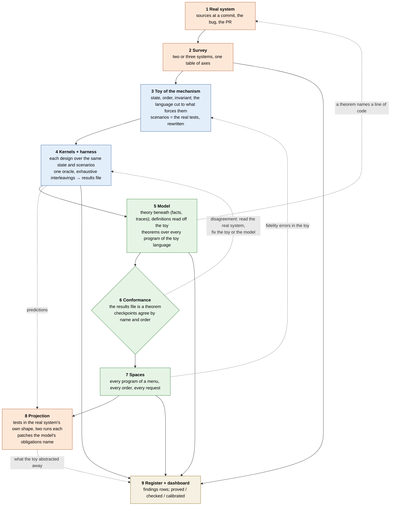

# distil-and-model

A method for questions of the form "is this fix complete?", "which of these designs is right?" or "what does this mechanism guarantee?" about a system whose mechanism has no specification, only code. It climbs from the real system to a formal model and back, and its product is a register of findings, each with evidence on the real system. [example.md](example.md) is one complete climb (a presentation compiler servicing requests in the middle of a type check); read it first, it is the shape to imitate.

Five other places the same climb applies, to show the range. In each, the toy keeps the state, the order and the invariant and drops the language around them:

| real system and question | mechanism to distil (state, order, invariant) | toy language | kernels | model and what it proves | space | projection back |
|---|---|---|---|---|---|---|
| An incremental build tool (Zinc, Gradle, Bazel): is this invalidation rule sound, and how much does it over-invalidate? | what a compilation read (its trace), what the bridge records (keys), which units an edit invalidates; invariant: incremental equals clean | classes and members with names, imports and implicits; an edit is a declaration added, removed or retyped | name hashing, a per-scope lookup tracker (Kotlin's), an action graph with content hashes | a unit task with a trace; a rule is a key with a cover; soundness as "keys cover the trace", precision as units invalidated minus units whose answers changed | every program of a menu, every single edit, both orders | scripted tests on the real tool that fail on its default rule; a PR stating each rule as a key |
| A coroutine or async transform (scala-async, Kotlin coroutines, Loom): is the state machine equivalent to the direct program under exceptions and `finally`? | the locals saved across a suspension point, the resumption state, the exception in flight; order: where suspension lands inside `try`/`finally`; invariant: same observable trace as direct style | a tiny imperative language with `await`, `try`/`finally`, assignment and a trace of effects | the ANF-plus-state-machine transform, a continuation-passing transform, a runtime that captures the stack | a direct semantics and the transformed semantics over the same programs; equivalence of effect traces for every program; the witnesses where a transform re-runs a `finally` | every program up to a size, suspension at every point, an exception at every point | the real transform's test suite gains the witness programs; a fix to the lowering of `finally` |
| JVM class initialisation under concurrency (HotSpot `<clinit>`, circular initialisation, deadlocks): which interleavings see a default-valued static, and which deadlock? | the five initialisation states per class, the initialising thread, the init lock; order: thread interleaving over static dependencies; invariant: a read after initialisation sees the initialised value, and no cycle deadlocks that the spec says must not | classes with static fields initialised from other classes' statics, and two or three threads that trigger them | the JVMS §5.5 procedure, a lock-per-class variant, a lazy-holder idiom | the state machine over all interleavings; a theorem that the spec's procedure never deadlocks on an acyclic dependency, and the witness cycles where it reads a default | every dependency graph of three or four classes, every interleaving of two or three threads | jtreg tests with a WhiteBox-controlled interleaving; a bug report with the smallest graph |
| Dependency resolution (Maven, Ivy, Coursier, Gradle): why does the same graph resolve to different versions by declaration order, and which resolver is a function of the graph? | the candidate set per module, the chosen version, the exclusion scope; order: traversal and declaration order; invariant: the result is a function of the graph, not of the order | a graph DSL: modules, versions, dependencies with ranges and exclusions | nearest-wins, highest-wins, a conflict manager with evictions, a SAT-based resolver | resolution as a fixed point over the graph; which resolvers are order-free, and the smallest graphs where the others are not | every graph of four or five modules, two or three versions each, every declaration order | reproductions in each tool's test format; the finding of order-dependence with the minimal graph |
| A concurrent garbage collector's barrier (G1's SATB, ZGC's load barrier, Shenandoah): does the mutator ever hide a live object from the marker? | object colours, the mark stack, the barrier's log; order: mutator writes interleaved with marker steps; invariant: tri-colour (no black object points to a white one at the end of marking) | a heap of a few objects with reference fields, mutator operations `read`, `write`, `allocate`, marker steps | Dijkstra insertion barrier, Yuasa deletion barrier, SATB, a load barrier with self-healing | the tri-colour invariant proved for each barrier over every heap and interleaving, and the witness interleaving where a barrier is turned off for one write | every heap of four or five objects, every interleaving of a handful of mutator and marker steps | a WhiteBox test that pins the interleaving; a bug report on the barrier elision the witness exhibits |

The common shape: a few state variables, an order the real system's tests sample at a handful of points, an invariant that is easy to state and expensive to test, and two or more real designs to put side by side.

## Trigger

A real system you can read the source of, and one *mechanism* of it: something with mutable state, an order of operations and an invariant, where a bug, a PR or a design question is about whether the invariant holds at every point the order allows. Interruption, cancellation, laziness and cycles, caching and invalidation, incremental rebuilds, phase ordering. Not a language feature's output (that is calibration against the real tool), not a performance number (that is a profiler), not a one-line fix with a test (the ladder costs days).

## The idea

1. A test suite samples a mechanism at a few points of its order. Enumeration samples all of them, but only on something small.
2. A **toy of the mechanism** keeps the state, the order and the invariant and drops the language around them. Its fidelity is a set of claims about the real system, each checkable by reading.
3. Competing designs become **kernels** over the same toy state and the same scenarios, with one harness and one oracle, so they are compared on equal terms, and a hypothetical design costs one more kernel.
4. A **model** is the toy ported into a proof assistant, definitions read off the toy, so that the toy's recorded results are a theorem about the model and the model's theorems quantify over every program of the toy's language.
5. **Conformance** between toy and model runs both ways beneath the real system, which stays the only reference: a disagreement is settled by reading the real system, never by editing one side to match the other.
6. The model runs **spaces** the toy never ran, and what survives every design there is a finding about the mechanism, not about a policy.
7. Every prediction is **projected back** as a test in the shape of the real system's own tests, and a patch where the model's obligations name one.

Red is the real system and what is done to it, blue the toy, green the model, parchment the register. The solid spine is the order of the rungs; the dotted edges are the two feedback loops, backward from the model to the toy's fidelity and forward from the toy and the model to tests on the real system. Every rung writes to the register.

## Why climb it

* **Iteration speed.** A real compiler costs a build per experiment and minutes per test; the toy runs every interleaving of a scenario in milliseconds, and the model runs a thousand scenarios in the time one real test takes. Design questions get answered in the loop where they are asked, and the real system is touched once, with the patch already known to be complete on the toy.
* **Abstraction focuses attention, human and agent.** The toy is small enough to hold in one head and in one context window: a reviewer reads it whole, an agent reads it whole, and neither has to carry the real system's incidental complexity. The kernels table and the policy bits become the shared vocabulary of the discussion: "the burst", "the consumed map", "safepoint 3", instead of file and line numbers in three codebases.
* **Exhaustive rather than sampled.** A test suite samples the order at the points its author imagined; the harness tries every point, and the space tries every program of a menu. What survives is a property of the mechanism, not of the imagined cases.
* **Hypotheticals are cheap.** A design nobody has built costs one more kernel or one more mode, and its obligations come out as theorems before anyone writes a patch.
* **Fidelity is checked, not assumed.** The toy's claims about the real system are listed and the space tests them indirectly: a result that contradicts a design's intent points at the claim that is wrong. Two systems written from one reading can be wrong together; the method is built to catch that.
* **The results do not rot.** The toy's output is a committed file and a theorem about the model; a change to either side that breaks the agreement fails the build. A finding carries its scenario, its theorem and its test, so it can be re-derived.
* **Honesty about scope.** Writing the toy forces the list of what was left out, and that list is where the real system's own tests go looking afterwards.

## Rungs

Each rung has questions to answer before moving on; the artefact is the answer. Commit after each rung; write a findings row the moment a finding appears.

**1. The real system.** Which identifiers name the mechanism, at which commit? Which test, PR or issue is the bug? Which invariant broke, over which state, at which point of the order? Artefact: a note with the mechanism in one paragraph and a table of the fix's parts against the kind of state each repairs, with file and line references.

**2. The survey.** Which other systems have the same mechanism, and where does each stand on each axis: where the work runs, what is cached and under what key, what the guard against re-entry is and whether an unwind resets it, how cancellation or invalidation arrives? Read sources at named commits, not documentation. Artefact: a subsection per system and a one-line comparison. A finding that reading alone settles is written now and the ladder may stop here.

**3. The toy.** What is the smallest language whose evaluation forces the mechanism's state? Keep only what the bug's fix touches. Which of the real system's tests become scenarios? Artefact: a toy in a plain language (one file per concept: syntax, the shared state, the scheduler, scenarios as text files, a run script), and a list of every design choice that is a claim about the real system.

**4. Kernels and the harness.** Can each surveyed design be written over the same state and scenarios? What is the oracle? (For an interleaving question: the answer when the event arrives after the work is done.) What does the harness enumerate exhaustively? Artefact: a kernels table (kernel, where the work runs, what it models), the harness, and a committed results file regenerated by the run script and never edited.

**5. The model.** Which existing theory does the mechanism sit on (a task with a trace, lazy facts with a black hole, a pushed fact with a freeze)? Which definitions are read off the toy: the facts of any program of the toy language as rules, and the kernel as a state machine over them? What is proved for every program, and what only by evaluation on a scenario? Prefer a kernel-checkable `decide` over native evaluation where it can run. Artefact: the modules, a claim-to-theorem table in the note.

**6. Conformance.** Is the toy's results file a theorem about the model, number for number, and are the toy's checkpoints the model's by name and in order? Artefact: that theorem, checked after every change to either side, and the results file regenerated beside it.

**7. Spaces.** What menu of declarations and requests covers the interactions the mechanism has? Run the harness over every program and order of the menu under every design. Which shapes survive every design? Artefact: the space module, the counts, a findings row per surviving shape. The first run usually debugs the toy: a result that contradicts a design's stated intent is a fidelity question first, answered by reading the real system for that program.

**8. Projection.** Which predictions have a test on the real system in the shape of its own tests? Run each twice, failing without the fix and passing with it, on a named commit in a clean tree. Which patch do the model's obligations name, and does it pass the system's suites? Artefact: tests and patches, issues or PRs on the real tracker, findings rows moved from triage to draft to filed.

**9. Register and dashboard.** A findings register (id, what, where, evidence, status, next step); a theorems page stating each theorem once with where its hypotheses bite; a status page separating "proved for every program" from "checked on a space" from "calibrated against the real tool"; the note's future-work list with boxes ticked as they close.

## Building on a previous toy and model

The second climb rarely starts from the ground. A mechanism's questions come in a sequence (laziness and cycles, then interruption over the same facts, then targeting and sessions, then incrementality over edits), and each wants the last toy and model as its floor. Before writing anything, answer these:

* **Does the existing toy language force the new state?** If the new mechanism's state is reached by the existing language's evaluation, the toy stays and the new question is a *mode* or a *kernel* on it (abort-and-restart was one `Mode` on the same kernel; the resumable session was one more kernel with a `runUpTo`). If it is not reached (edits inside a body, positions, identity across runs), the language needs a feature, and the fidelity list gains a claim per feature. If the feature would change what every existing scenario means, that is a new toy, and the old one is kept as the floor it is.
* **Which of the old theorems become lemmas?** A theorem that quantified over hand-written rule sets should, once the toy's programs can be mapped to rules, be restated over every program of the toy language, by `decide` where it was by hand. The old statement is kept and the new one cites it. (Track L's order-dependence findings were two hand-written rule sets; with the namer as rules over programs they became theorems about the programs that showed them.)
* **Does the old conformance theorem still hold?** Extending the language or the kernel regenerates the old results file and re-checks the old theorem before the new one is written; a number that moves is either a fidelity correction, recorded as such, or a regression.
* **Which layer does the new question live in?** A mechanism that is about the *facts* (abort, reordering, peeking) goes into the theory beneath the kernel and is proved for every rule set; one that is about the kernel's *non-fact state* (a burst, a consumed map, a cache) goes into the kernel and is checked by `decide` on scenarios; one that is about what the facts are *keyed by* (runs, revisions, edits) is a new layer between the two. Putting it in the wrong layer either makes it unprovable or makes it a claim about one kernel.
* **What does the old toy abstract away that the new question is about?** Read the old "what it cannot do" list; the new question is usually on it. If the answer is "trees", the next toy has trees, and the old one's kernels are its oracle for everything that is not about trees.
* **Which findings of the old climb are hypotheses of the new one?** A triage row that the new toy can settle becomes its first scenario.

The artefact is a section at the top of the new note saying what is inherited (the theory, the language, the kernel, the harness, the results file), what is added, and which old theorems are restated.

## Checks

* Every file, declaration and tracker reference named in a note is a link, and a lint enforces it, so a renamed theorem breaks the note that cites it.
* The conformance theorem is re-checked after every change to the toy or the model; the results file is regenerated by the run script.
* A result that only the compiled evaluator produces, and the kernel checker does not return on, is recorded as an observation with the stall, never as a theorem; the status page's "proved" column is the kernel's alone.
* A confirmation on the real system names the commit and the tree state and consists of two runs. One passing or failing run confirms nothing; a run from a tree that still had a patch applied is the classic false confirmation.
* A disagreement between the toy and the model is settled by reading the real system for the specific case. Agreement between two things written from one reading is not evidence.
* A planned theorem that turns out vacuous is kept and reported as such; it is a finding about the question.

## Stop conditions

* A rung's question is answered by reading alone: write the finding and stop. The ladder is not a quota.
* The toy cannot hold the mechanism without a feature it left out: stop, record what the next toy needs, and do not stretch this one.
* A prediction has no test the real system can run: it stays in triage, and the note says why.
* The toy and the model disagree and the real system cannot be read for the case: record the disagreement as open; do not pick a side.

## What it cannot do

The toy abstracts, and the abstraction is the claim: anything the toy left out (trees with positions, edits inside a body, identity across runs, consumed attachments, a search the request runs after the mechanism) is where the real system's own tests will find what the toy could not. The model sees less than the toy, and its executable semantics decides small scenarios, not the space. Neither measures cost; a work counter ranks designs. And the real system is the only reference, because toy and model share their author's reading.
