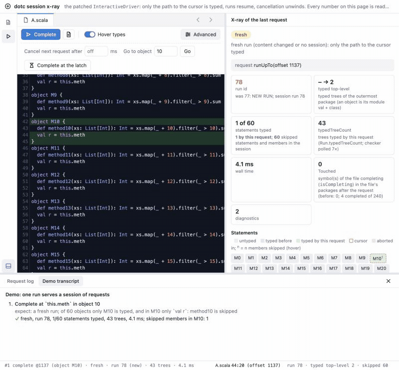
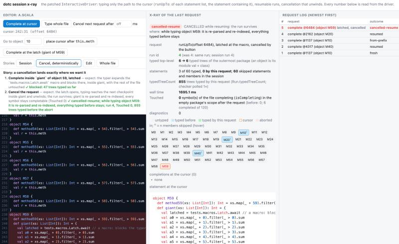
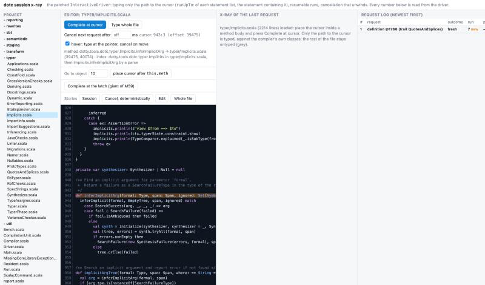
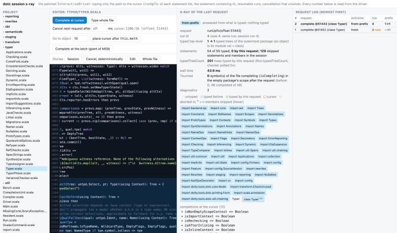

# dotc session x-ray: a toy IDE over the patched `InteractiveDriver`



A web page that calls into the real Scala 3 compiler with [`dotc-session.patch`](../../../../../docs/upstream/dotc-session.patch) applied (typing only the path to the request with `runUpTo`, a resumable run per file, cancellation that unwinds with `CancelledCompilation`), and shows an x-ray of what the driver did for each request: run id, which top-level statements are typed and which of their members were skipped, where a cancellation unwound, `Run.typedTreeCount` consumed, wall time, how many symbols of the file are still `Touched` (`isCompleting`) afterwards, and whether the run is tainted (a cyclic reference prevented: the next request starts fresh). Every number is read from the driver; nothing is simulated. [track-i-dotc-session-design.md](../../../docs/track-i-dotc-session-design.md) is the design these numbers illustrate.



## Files

- [`XrayServer.scala`](XrayServer.scala): a `com.sun.net.httpserver` server (no new dependencies) that owns one `InteractiveDriver` on the presentation-compiler test classpath and one virtual file `A.scala`. `GET /` serves the page, `GET /source` the generated file (60 top-level objects in the shape of `CompletionSessionSuite.bigSource`), `POST /request` runs one request (`complete`: `runUpTo` at the cursor then `Completion.completions`; `full`: `run`) with an optional cancel checker that fires after N ms, and answers with the x-ray as JSON. The driver's `typedTreeCount` is read reflectively so that the compiler patch stays exactly [`dotc-session.patch`](../../../../../docs/upstream/dotc-session.patch).
- [`xray.html`](xray.html): the page. CodeMirror 5 for the editor and highlight.js for the statement under the cursor, both from cdnjs; the palette and editor theme are borrowed from the viewer of [retronym/greffier](https://github.com/retronym/greffier) (its compile drawer is the natural home for this page later). Four stories, each stating what the design predicts before a step and checking it against what the driver reported: *session* (complete in object 10, 40, 10 again, then inside `method20`: one run, only the statements at the cursor typed), *cancel, deterministically* (a latched request, see below, cancelled while the typer is blocked, then the same request again), *edit* (a fresh run), *whole file* (`driver.run`, for comparison).
- `tests.macros.Latch` (in the scratch worktree's `presentation-compiler-testcases/src/tests/macros/Latch.scala`, part of the patch): a `transparent inline` macro that blocks the typer while the latch file exists. The generated file's last object has `def giant` whose first statement is `val latched = Latch.await`, and whose last statement depends on `latched`; a "latched" request at that last statement arms the file, the page shows the typer blocked there with the tree count so far, and *Cancel* or *Release* decides what happens next. This is how a cancellation lands at a known point, deterministically, instead of at whatever the 1,024-tree checkpoint happens to hit. Since targeting applies to the statements of a block too, a request elsewhere in `giant` does not block: the macro is expanded only when the statement at the cursor depends on it, which is the honest demonstration of the laziness. (Finding I19 was found here: the macro's inlined trees carry its own source, and the skip rule had compared their spans with the request's offset.)

## The page

Four columns: an explorer over a snapshot of the compiler's sources (see below), the editor, the x-ray of the last request, and the request log; the borders between them drag, and the log collapses into the status bar at the bottom, which shows the latest request in one line, the file and cursor, the session's run id, typed top-level count and skipped count, and the hover state. The editor header has back/forward buttons (Alt+←/→) over the positions a file load or a definition jump came from. The demos (session, cancel, edit, whole file) narrate each step with the design's prediction and a ✓ or ✗ against what the driver reported; *Clear* empties the transcript, the log and the x-ray. The x-ray's last box shows the innermost enclosing definition at the cursor (a `def`, `val`, class or object), not the whole top-level statement.

The outcomes are `fresh` (a new run: new content or no session), `resumed` (the same run typed the statement or member at the cursor), `served` (nothing typed), `full` (the whole file), `cancelled-resume` / `cancelled-fresh`.

## Hover mode

On by default: resting the pointer on an identifier for 150 ms sends a `typeAt` request (`runUpTo` at the identifier's end, then the innermost typed tree there: its symbol with its signature, its widened type, its span and enclosing definition), run on the server's request thread so that it can be cancelled; moving to another identifier before the answer arrives sets the driver's cancel flag, the typer unwinds at its next checkpoint, the answer is dropped, and the popup for the new identifier replaces it. Staying shows the popup with the type and the x-ray summary (`served` / `resumed` / `fresh`, trees, ms). Every hover request is a row in the log, cancelled ones included, so the log is the trace of what the compiler did while the pointer wandered: on the generated file a first hover is a fresh run of 67 trees (51 ms), the next in another object a resume of 65 trees (6 ms); on `Typer.scala` a hover into an untyped method is a resume of that method, and one that moves on before the 450 ms fresh run finishes is cancelled inside it.

## Go to definition

⌘/Ctrl-click on an identifier, or *Go to definition* in the right-click menu (which also offers *Type at the pointer* and *Complete here*). A `definition` request runs `runUpTo` at the identifier and takes the symbol of the innermost typed tree there. A symbol of the current file is found by its own span. Any other is found through an index of the snapshot's top-level definitions, built by one parse pass over the 478 files on the first request (917 definitions, 634 ms): the symbol's top-level class gives the file, then a parse of that file walks the owner chain of names to the member. The page loads the file and highlights the definition's line; the x-ray's request row says which route was taken. Symbols outside the snapshot (the standard library) report their TASTy path instead. From `QuotesAndSplices.scala`: `inferImplicitArg` → `typer/Implicits.scala`, `defn` → `core/Symbols.scala`, `QuotesClass` → `core/Definitions.scala`, each a few milliseconds after the first.



## Real compiler sources

The explorer panel on the left lists a snapshot of `compiler/src/dotty/tools/dotc` at the base commit (478 files); a click loads the file into the editor, and every request on it runs against the compiler's own classes (the server's driver uses the whole test JVM's classpath: `scala3-compiler`, `scala3-library`, `scala-library`, `scala-reflect`, `tasty-core`, the asm jars). A completion inside `Typer.typedSelect` on `Typer.scala` (5,532 lines) is a fresh run that types the 53 imports and `class Typer` with 129 of its members skipped, `object Typer` skipped: 1,362 trees, 450 ms cold; a second request in the same method is served from the run. The snapshot is made once from the worktree root, so that the files do not move under the page and the patch's own edits are not what is shown:

```bash
mkdir -p out/xray-sources && git archive d168df2a76 compiler/src/dotty/tools/dotc | tar -x -C out/xray-sources
```

(`-Dxray.sources=<dir>` points the server elsewhere.) The stories run on the generated file only.



## Running it

The live copy runs inside a scala3 worktree at `d168df2a76` with [`dotc-session.patch`](../../../../../docs/upstream/dotc-session.patch) applied (`git apply`), with [`XrayServer.scala`](XrayServer.scala) and [`xray.html`](xray.html) copied to `presentation-compiler/test/dotty/tools/pc/xray/` (the patch carries the latch macro):

```bash
sbt --mem 8192 -batch "scala3-presentation-compiler/Test/runMain dotty.tools.pc.xray.XrayServer"
```

Then open <http://127.0.0.1:8791/> (`-Dxray.port=...` to change; `-Dxray.page=<path>` if the page is not found relative to the working directory; `-Dxray.latch=<file>` enables latched requests, the sbt route sets neither, so for the latch run the server directly: `sbt "export scala3-presentation-compiler/Test/fullClasspath"`, then `java -Dxray.latch=/tmp/xray-latch -cp <that classpath> dotty.tools.pc.xray.XrayServer` from the worktree root). The first build is about 2.5 minutes; the server warms the driver up on a 5-object file before listening. `Ctrl/⌘-Space` in the editor is "Complete at cursor". The page is read from disk on every request, so it can be edited without a rebuild.

## What the numbers were (60 objects, warm JVM)

| request | typed | `typedTreeCount` | ms |
|---|---|---|---|
| fresh completion in object 10, prefix version of the patch | 11 statements whole | 791 | 20–40 |
| fresh completion in object 10, path version | `val r` of object 10 only | 43 | 12–60 |
| resume into object 40 | one more statement | 41 | 7 |
| served from what is typed | nothing | 8 | 1–3 |
| whole file | 60 statements | 12,097 | 357 |
| latched request cancelled inside `giant` | nothing; object 59 re-parsed | 981 before the abort | |
